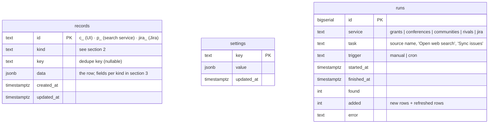

# Historica Analyst Hub — database schemes

Everything the hub stores, in one place. Verified against `lib/db.js`, `lib/registry.js`, `lib/jira.js`, `lib/pipeline.js`, the service folders and `public/index.html` (state at 5 Nov 2026).

**Where data lives**

| Store | What | Where |
|---|---|---|
| **Postgres (Neon)** | All hub data: 3 tables (`records`, `settings`, `runs`) | Vercel → Storage; `DATABASE_URL` |
| Browser `localStorage` | Only UI convenience (`historica_hub_ui_v1`: selected template, template variables, letter context). Not data. | each viewer's browser |
| Old bot `historica-grant-bot/data/seen.json` | Old Telegram bot memory. The bot itself is not deployed (its logic lives in `funds/`). A snapshot of its history is bundled as `funds/seen-data.js` and **imported automatically** (rows get `found: "bot"`) when you press Grants → ↻ Update. | `funds/seen-data.js` → `records` |
| `social_analysis/` (`fb.py`, `linkedin.py`) | Social service — **no database yet** (to be built; will get its own `kind`s or tables) | — |

There are only **three SQL tables**. Almost all business data is stored in one generic table, `records`, as JSON — one row per table row you see in the UI, told apart by `kind`.

---

## 1. SQL tables



No foreign keys: `runs.service` and `records.kind` are plain text. Indexes: `records(kind, created_at)`, `records(kind, key)`.

### `records`
| Column | Type | Notes |
|---|---|---|
| `id` | text, PK | Browser rows `c_<uuid>`, rows found by a service `p_<uuid>`, Jira rows `jira_<ISSUE-KEY>`. The browser keeps the id in each row as `_id`. |
| `kind` | text | Which table/collection (section 2). |
| `key` | text | Normalised key used to de-duplicate (see "Dedupe keys"). Null for kinds without one. |
| `data` | jsonb | The row itself. |
| `created_at`, `updated_at` | timestamptz | Set by the database. |

### `settings` (key → JSON value)
| Key | Value | Purpose |
|---|---|---|
| `seeded` | `true` | The first-launch demo data was uploaded (universities, communities, templates, first grants). |
| `seeded_kinds` | `["rivals","rivalDirs","mapq","roadmap"]` | Collections added later that were already seeded once, so deleted rows do not come back. |
| `service:<id>` | `{profile?, sources?, queries?}` | Overrides saved through `PUT /api/services` (the Search services page that edited them was removed; code defaults apply unless set). `{}` = defaults. `<id>` = grants / conferences / communities / rivals. |
| `cursor:<id>` | integer | Daily cron position: which source each service checks next. |
| `jira:last` | `{at, count}` | Time and size of the last Jira sync. |

### `runs` (log of every search/sync)
One row per source check or Jira sync. `found` = items returned; `added` = new rows (+ refreshed rows for rivals). `error` is filled when it failed. Not shown in the UI any more (Search services page removed); query the table directly.

---

## 2. Collections (`records.kind`)

| kind | UI page | Written by | Dedupe key | Notes |
|---|---|---|---|---|
| `grants` | Grants & Funding | UI + Fund search service | `normName(name) \| normUrl(link)` | |
| `confs` | Conferences | UI + Conference search | `normName(name)` | |
| `comms` | Communities | UI + Community search | `normUrl(url)` or `normName(name)` | |
| `rivals` | Rivals analysis → Rivals | UI + Rivals analysis | `normName(name)` | Service **refreshes** existing rows (`whatNew`, `lastChecked`) instead of skipping them. |
| `rivalDirs` | Rivals → Directions & claims | UI only | — | Seeded from the Oct 2026 report. |
| `mapq` | Rivals → Map quality analysis | UI only (manual or imported benchmark report) | — | Matched on region + year when importing. |
| `mapqIn` | Project progress → Map quality → before/after | UI only (filled by the tab's ↻ Update, which reads `<zone>_<period>/<zone>_report.json` files from the map_score_service `out` folder in the browser) | — | One row per zone + period; re-reading a report refreshes the row. |
| `roadmap` | Project progress | UI only | — | Seeded from `historica_roadmap.html`. |
| `unis` | Academic Outreach | UI only | — | No search service (manual). |
| `testers` | Map Builder Testers | UI only | — | No search service (manual). |
| `tplList` | Templates & Letters | UI only | — | Seeded with the built-in templates. |
| `funnels` | Analytics → Funnels | UI only | — | Saved funnels. |
| `jira` | Project progress (Roadmap + Jira analytics tabs) | **Jira sync only** (read-only for the browser) | `key` = issue key | Full re-sync: rows no longer returned by the JQL are deleted. |

*Dedupe keys:* `normName` = lower-case, letters/digits only, single spaces. `normUrl` = lower-case, no `https://www.`, no query/hash, no trailing slash.

Rows added by a service carry `isNew: true`, `found: "ai"`, `firstSeen` (YYYY-MM-DD). In the UI ✓ clears `isNew`; ✕ and 🚫 ("never show again") set `hidden: true` + `hiddenAt` — hidden rows stay in the DB, so the service never re-adds them or near-identical copies. ↩ removes the flag. **Find duplicates** hides copies with `hidden: true` and `dupOf` (name of the kept row); nothing is deleted. Duplicate rules: `lib/dedupe.js` (same URL incl. #fragment, or similar names after dropping filler words; different explicit years = different opportunities).

*Fuzzy match is applied to `grants`, `confs`, `comms` — both when a search adds rows and in the Find duplicates button.*

---

## 3. Row shapes (`records.data`)

`_id` is added by the browser and is not stored inside `data`.

### `grants`
| Field | Example / values |
|---|---|
| `name`, `source`, `link` | "NGI Zero Commons Fund", "NLnet", URL |
| `deadline`, `sum`, `period` | text or `"unknown"` |
| `oss`, `articles` | `Yes` / `No` / `?` — open-source required? scientific articles required? |
| `docs` | documents required (comma list) |
| `note`, `kind` (`grant`…), `consortium` (`yes`/`no`/`unclear`) | service output |
| `applied` | `No` / `Yes` |
| `result` | `—` / `Pending` / `Accepted` / `Rejected` |
| `isNew`, `hidden`, `found`, `firstSeen` | flags (see above) |

### `confs`
`name`, `focus`, `date` (YYYY-MM-DD or text), `loc`, `country` (optional; if empty the UI takes the last part of `loc`), `format` (`in-person`/`online`/`hybrid`/`unknown`), `deadline` (CFP), `costText` (as stated), `cost` (number, €), `link`, `note`, `source`, `applied` (`No`/`Planned`/`Yes`), `result` (`—`/`Pending`/`Accepted`/`Rejected`), flags.

### `comms`
`name`, `platform`, `audience`, `url`, `priority` (`Very high`/`High`/`Medium`), `approach`, `goal` (`Acquisition`/`Feedback`/`Partnership`), `rules`, `size`, `note`, `source`, `contact`, `date` (last contacted), `status` (`Not started`/`Joined`/`Contacted`/`Posted`/`Replied`/`Partnership`), `responses`, `visits`, `testers` (numbers), flags.

### `rivals`
| Field | Meaning |
|---|---|
| `name`, `link` | rival and its URL (`""`/`#` = not verified yet) |
| `market` | who it is for, platforms, price model |
| `whatNew` | what they launched recently (refreshed by the service) |
| `take` | what Historica can take from them |
| `better`, `worse` | where Historica is ahead / behind this rival |
| `lastChecked` | YYYY-MM-DD |
| `source` | task that found it, or `manual` / `Oct 2026 reports` |
| flags | `isNew`, `hidden`, `found`, `firstSeen` |

### `rivalDirs`
`type` (`direction` = one of the 5 report directions, `claim` = one of our claimed advantages), `title`, `verdict` (`Ahead`/`Supported`/`Partly supported`/`Mixed`/`Unclear`/`Unproven`/`Not tested`/`Behind`), `best` (best competitor), `why`, `action`.

### `mapq` (map-quality benchmark, one row = one region + year)
`region`, `year`, `ours`, `rivals` (overall "common score", 0–100; rivals = mean of 5 maps), `countryOurs`, `countryRivals`, `borderOurs`, `borderRivals`, `best` (best rival map), `wrong` (e.g. `"7 of 41"` wrong borders on our map), `date`, `note`. Δ is computed in the UI (`ours − rivals`).

### `mapqIn` (before/after map comparison, one row = one zone + period)
`zone`, `period`, `beforeCommon`/`afterCommon`, `beforeCountry`/`afterCountry`, `beforeBorder`/`afterBorder` (0–100), `afterRecall`, `afterPrecision`, `afterWrong`, `afterBorders`, `afterExpected` (inputs of the worked example), `verdict`, `summary`, `improved[]`, `worsened[]` (item titles), `unchanged` (count), `beforeMap`, `afterMap` (file names), `llm`, `date` (report file date), `src`. The `mapq` rows may also carry `rivalScores` (`{rival: common score}`) and `src` when filled by the Map quality tab.

### `roadmap`
`lane` (`maps`/`builder`/`community`/`analytics`/`funding`), `q` (quarter index 0–4 = Q4 2026 … Q4 2027+), `title`, `status` (`idea`/`planned`/`progress`/`done`), `goal` (`q` = quality, `a` = adoption), `why`, `metric`, `jira` (Jira epic key or label that drives the progress bar; empty = none).

### `jira` (read-only mirror of issues)
`key`, `summary`, `status`, `cat` (Jira status category: `new`/`indeterminate`/`done`), `type`, `assignee` (`Unassigned` if none), `priority`, `labels[]`, `created`, `updated`, `resolved`, `due` (YYYY-MM-DD or empty), `epic` (parent key), `epicName`, `points` (story points, 0 if the field is empty), `url`.

### `unis`
`name`, `country`, `dept`, `contact`, `email`, `wrote` (`Not yet`/`Drafted`/`Sent`/`Replied`), `status` (`Prospect`/`Contacted`/`In conversation`/`Pilot`/`Declined`), `last` (date of last touch). **Contains personal data (names, emails of university staff).**

### `testers`
`id` (`T-001`…), `role`, `src` (where they came from), `fb` (feedback channel: `None`/`Form`/`Interview`/`Both`). Personal data is not collected here beyond role/source.

### `tplList`
`name`, `type` (`Communities`/`Conferences`/`Custom`/…), `subject`, `body` (with `{{variables}}`).

### `funnels`
`name`, `steps[]` (event names from the tracking spec), `win` (`1d`/`7d`/`30d`).

---

## 4. How data gets in

```
Browser (edits)  ──POST /api/sync (only changed rows)──▶ records   [kinds in SYNCABLE; not 'jira']
Update buttons    ──/api/run, /api/cron (OpenAI + web search)─▶ records (new rows) · runs
Jira             ──/api/jira (POST) · daily cron──────▶ records kind 'jira' (full re-sync) · runs · settings jira:last
Browser load     ◀──GET /api/state──────────────────── all records + seeded flags
```

**↻ Update buttons:** Conferences → Conference search · Grants → bot-history import (`POST /api/seen`) + Fund search · Communities → Community search · Rivals → Rivals analysis · Project progress → Jira sync. Academic Outreach and Map Builder Testers are manual tables (no service).

## 5. Not in the database (yet)

- **Analytics dashboards** (website, map, social, publicity, map-builder numbers, funnel rates) are **illustrative demo data in the page code**. Real numbers need the tracking events from the tracking spec (P0) and a connection to Mixpanel / the social service.
- **Social network data** (Facebook, LinkedIn, newsletter) — reserved for the social service.
- **Users / accounts** — none. One shared password (`APP_PASSWORD`) protects everything; there is no user table.

## 6. Environment variables (secrets live only in Vercel)

`DATABASE_URL`, `APP_PASSWORD`, `SESSION_SECRET` (optional), `CRON_SECRET`, `OPENAI_API_KEY`, `OPENAI_MODEL`, `OPENAI_REASONING_EFFORT`, `CRON_CHUNK`, `JIRA_BASE_URL`, `JIRA_EMAIL`, `JIRA_API_TOKEN`, `JIRA_PROJECT` or `JIRA_JQL`, `JIRA_STORY_POINTS_FIELD`. Template: `.env.example`.
